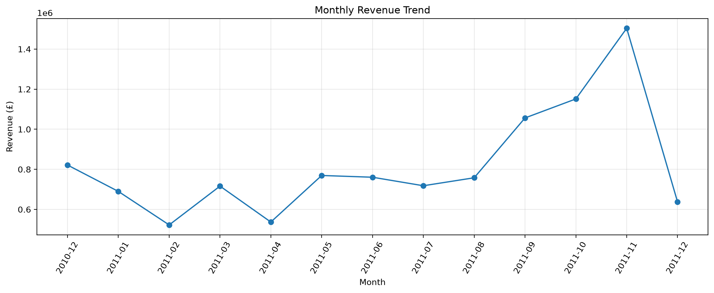
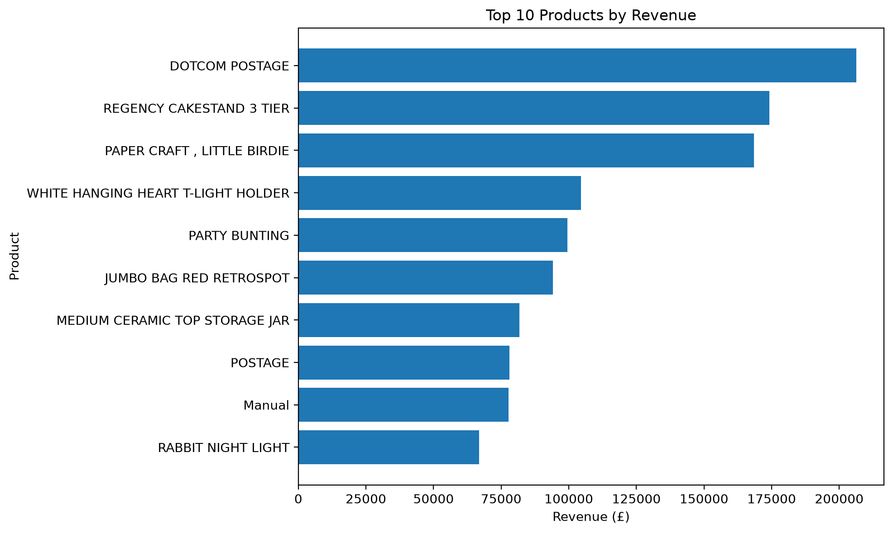
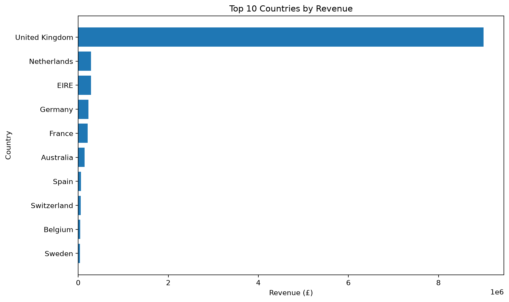
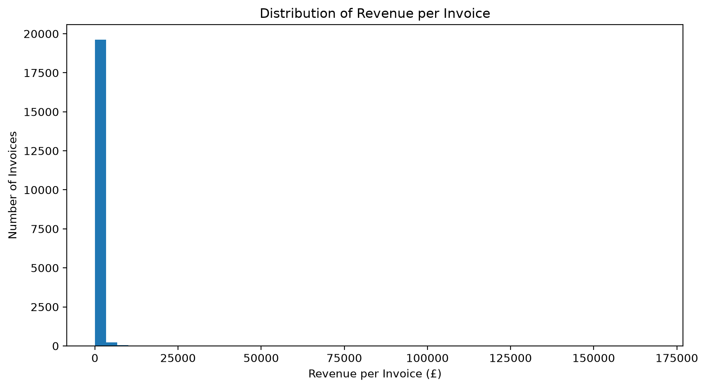
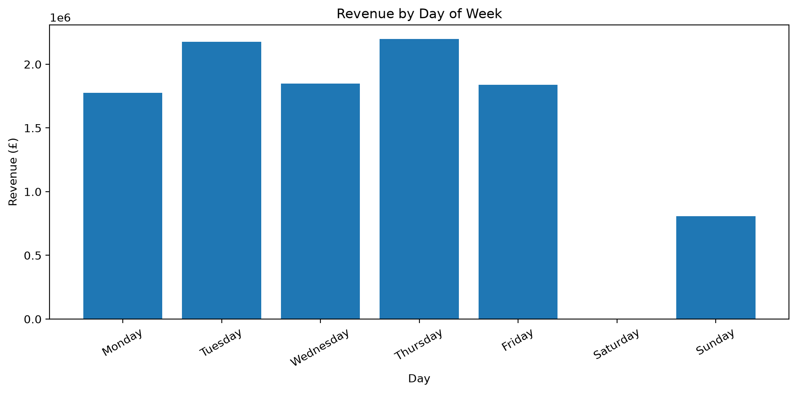

# Online Retail Exploratory Data Analysis (EDA)

## Project Overview

This project performs Exploratory Data Analysis (EDA) on an online retail transaction dataset using Python. The analysis focuses on understanding sales performance, identifying top-performing products and countries, examining monthly revenue trends, and exploring customer and invoice activity.

The project also demonstrates data cleaning, data quality assessment, descriptive statistics, and data visualization as part of a typical data analyst workflow.

## Objectives

- Inspect the structure and quality of raw transaction data.
- Identify missing values, duplicate records, cancelled invoices, and invalid transaction values.
- Clean the dataset using documented data preparation rules.
- Calculate key business performance indicators.
- Analyze monthly revenue trends.
- Identify products with the highest revenue and sales quantities.
- Compare sales performance across countries.
- Explore customer activity and invoice revenue distribution.
- Present findings through charts, summary tables, and business recommendations.

## Dataset

**Dataset:** Online Retail  
**Source:** [UCI Machine Learning Repository — Online Retail](https://archive.ics.uci.edu/dataset/352/online+retail)

The dataset contains transaction records from a UK-based online retailer. The main fields include:

| Column | Description |
|---|---|
| `InvoiceNo` | Invoice identifier |
| `StockCode` | Product identifier |
| `Description` | Product description |
| `Quantity` | Number of units in a transaction line |
| `InvoiceDate` | Date and time of the transaction |
| `UnitPrice` | Price per unit |
| `CustomerID` | Customer identifier |
| `Country` | Customer's country |

The raw dataset is provided by the UCI Machine Learning Repository. Please refer to the original source for the dataset documentation and usage information.

## Tools and Technologies

- **Python** — data analysis and processing
- **Pandas** — data manipulation and aggregation
- **NumPy** — numerical operations
- **Matplotlib** — data visualization
- **Jupyter Notebook** — interactive analysis
- **GitHub** — project documentation and version hosting

## Data Cleaning and Preparation

The raw dataset was inspected for missing values, duplicate records, invalid numeric values, and cancelled invoices.

The following preparation rules were applied:

1. Removed exact duplicate rows.
2. Excluded rows with missing invoice identifiers, invoice dates, quantities, or unit prices.
3. Identified cancelled invoices using invoice numbers beginning with `C` and excluded them from the regular-sales dataset.
4. Excluded non-cancelled rows with non-positive quantities or unit prices from regular-sales analysis.
5. Retained rows with missing `CustomerID` when the other required transaction fields were valid.
6. Retained rows with missing product descriptions when the other required fields were valid.
7. Calculated transaction-line revenue as `Quantity × UnitPrice`.
8. Created time-based fields for monthly and weekday analysis.

These rules define the scope of the regular-sales analysis. Cancelled invoices and negative quantities may represent returns or other adjustments, so they should not automatically be interpreted as invalid records in every business context.

## Key Performance Indicators (KPIs)

The analysis calculates the following indicators:

- Total revenue
- Total units sold
- Number of unique invoices
- Number of identifiable customers
- Number of unique products
- Number of countries represented
- Average revenue per invoice

Revenue is calculated from transaction quantity multiplied by unit price. It should not be interpreted as net profit because product costs and other operating expenses are not calculated in this project.

## Analysis and Visualizations

### 1. Data Quality Assessment

Examined dataset dimensions, column types, missing values, duplicate rows, and unusual transaction values before preparing the analysis dataset.

### 2. Monthly Revenue Trends

Aggregated revenue, units sold, and invoice counts by month to identify changes in sales activity over time.



### 3. Product Performance

Ranked products by total revenue and quantity sold to distinguish high-revenue products from high-volume products.



### 4. Country-Level Sales Analysis

Compared revenue, units sold, invoices, and identifiable customers across countries to understand the geographic distribution of sales.



### 5. Customer and Invoice Analysis

Examined revenue generated by identifiable customers and explored the distribution of revenue across invoices. Transactions without a customer identifier were excluded from customer-level analysis but retained for general sales analysis when otherwise valid.



### 6. Weekday Analysis

Compared revenue and unique invoice counts across days of the week to explore differences in transaction activity.



## Key Findings

*Complete this section after running the notebook and reviewing the actual outputs.*

- **Overall performance:** [Insert total revenue, units sold, and unique invoice count.]
- **Monthly trends:** [Identify the highest-revenue month and any notable trend.]
- **Product performance:** [Identify the leading product by revenue and compare it with the leading product by quantity.]
- **Geographic performance:** [Identify the country with the highest revenue and its contribution to total revenue.]
- **Customer activity:** [Describe a relevant finding from the customer or invoice analysis.]
- **Business recommendations:** [Provide practical recommendations supported by the observed results.]

## Business Recommendations

Recommendations should be based on the completed analysis. Potential areas to investigate include:

- Reviewing inventory planning for products with consistently high sales volumes.
- Evaluating the sales contribution of major geographic markets.
- Investigating monthly revenue fluctuations before making seasonal planning decisions.
- Exploring customer retention opportunities using transactions with identifiable customer IDs.
- Reviewing cancelled invoices and negative transactions separately to understand returns and accounting adjustments.

These are potential analytical directions, not confirmed findings.

## Limitations

- Revenue represents transaction-line sales calculated from quantity and unit price; it is not a measure of profit.
- Missing customer identifiers limit customer-level analysis.
- Excluding cancelled invoices and non-positive transaction values means the results do not represent a complete returns or accounting reconciliation analysis.
- Results depend on the selected cleaning rules and the available fields.
- Observed patterns describe the dataset and do not establish causal relationships.

## Project Structure

```text
python-online-retail-eda/
├── notebooks/
│   └── retail_eda.ipynb
├── outputs/
│   ├── figures/
│   ├── tables/
│   └── key_findings.txt
├── README.md
└── requirements.txt
```

## How to Run

1. Clone or download this repository.
2. Download the Online Retail dataset from the UCI Machine Learning Repository.
3. Place `Online Retail.xlsx` inside a local `data/` directory.
4. Install the required libraries:

   ```bash
   python -m pip install -r requirements.txt
   ```

5. Open `notebooks/retail_eda.ipynb` in VS Code or Jupyter Notebook.
6. Run the notebook cells in order to reproduce the analysis.

The raw dataset is not required to be included in the public repository; download it from the original source when reproducing the project.

## Author

**Izzatul Al Nabila**

Aspiring Data Analyst | Python | SQL | Power BI
